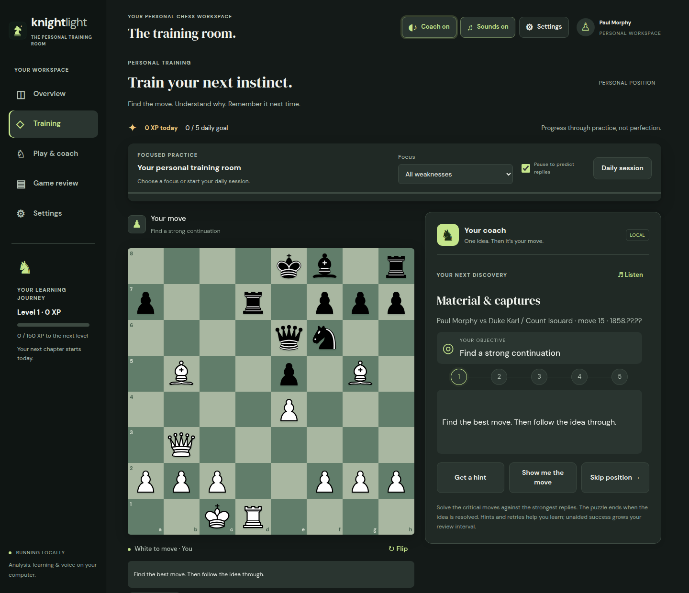
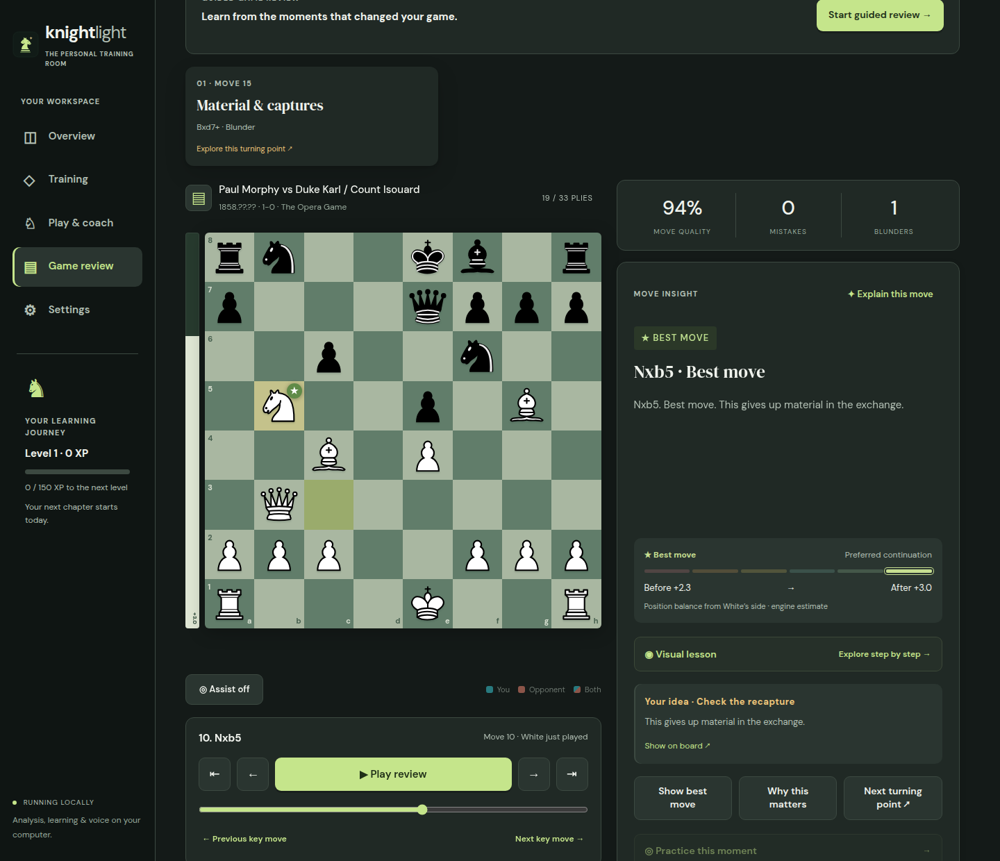
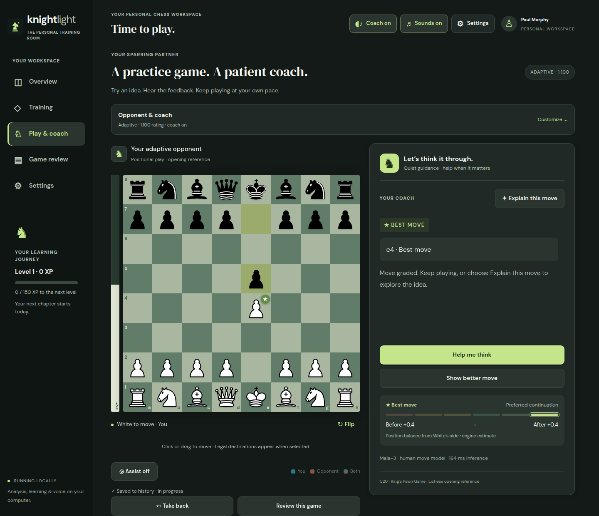
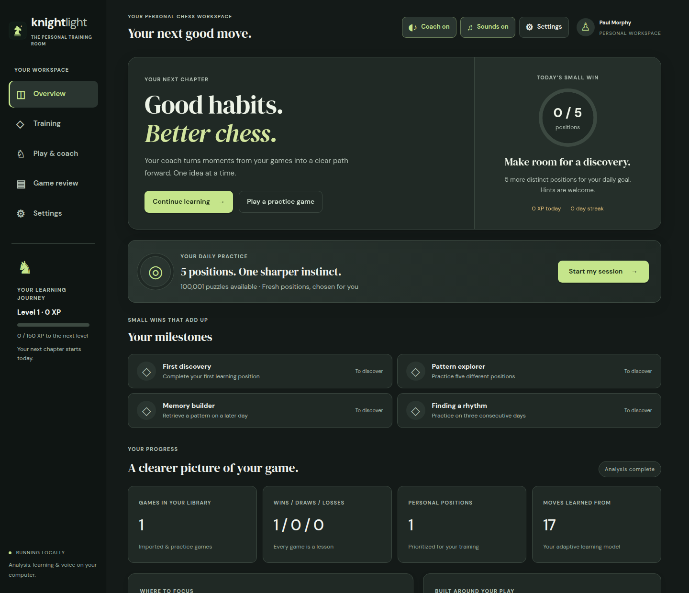

# Knightlight

Your personal chess training room. Review your games, practise your weaknesses, and play a human-like opponent that adapts as you improve—with spoken coaching and visual explanations, all running locally on your computer.

**[Download Knightlight](https://github.com/HyperCactus/knightlight/releases/latest)** · Windows, macOS, and Linux · No account or subscription

## Install

Download the file for your computer from the [latest release](https://github.com/HyperCactus/knightlight/releases/latest):

| Your computer | Download | Install |
| --- | --- | --- |
| **Windows 10/11** | `*_x64-setup.exe` | Run the installer, then open **Knightlight** from Start. |
| **Mac · Apple Silicon** (M1 or newer) | `*_aarch64.dmg` | Open the disk image and drag **Knightlight** into **Applications**. |
| **Mac · Intel** | `*_x64.dmg` | Open the disk image and drag **Knightlight** into **Applications**. |
| **Ubuntu / Zorin / Debian** | `*_amd64.deb` | Open in your software installer, choose **Install**, then launch **Knightlight** from the app menu. |

macOS 14+ and 64-bit Windows/Linux are supported; DEB builds target Ubuntu 24.04+, Zorin 18+, and Debian 13+. No Rust, Python, or model setup is needed. Windows may download Microsoft's WebView2 runtime during installation. The app works offline afterward.

Installers are not yet publisher-signed or Apple-notarized, so your system may ask for permission to open them. See the [installation guide](docs/DESKTOP.md#first-launch) for help, portable Linux AppImages, updates, and data migration.

## Features

- **Training tailored to you.** 100,000 offline puzzles plus positions from your own games, selected around your weaker patterns and current ability.
- **An opponent that grows with you.** Adaptive difficulty, or a 400–2,400 rating slider, with varied human-like play styles.
- **A coach you can see and hear.** Local neural speech, animated continuations, arrows, and highlights explain the idea behind a move.
- **Game review that teaches.** Follow your games move by move, explore better alternatives, and occasionally try an important response from your opponent’s side.
- **Progress that sticks.** Daily goals, XP, spaced review, and a history-weighted practice rating. Import/export PGNs; bot games save automatically.
- **Make it comfortable.** Dark mode, board themes, optional threat overlays, adjustable narration, sound controls, and reduced motion.

More screenshots

### Review your games

### Play and learn

### See your progress

Screenshots use a separate example library featuring Paul Morphy’s Opera Game.

## More information

Games, settings, and learning progress stay in a separate local profile and survive app upgrades. Automatic updates are available on Windows, macOS, and Linux AppImage; DEB installations update through a newer package. [Installation and data details →](docs/DESKTOP.md)

An optional browser edition is also available. See the [web guide](docs/WEB.md). For controls and the learning algorithms, read the [user guide](docs/USER-GUIDE.md) and [teaching notes](docs/TEACHING.md).

**Contribute:** bug reports, ideas, and pull requests are welcome. Start with [contributing](CONTRIBUTING.md) and the [development guide](docs/DEVELOPMENT.md).

**Licence:** Knightlight’s original source is [Apache 2.0](LICENSE). Bundled engines, models, artwork, and other dependencies retain their own licences, including GPL/AGPL terms for compiled distributions. See [NOTICE](NOTICE) and [component credits](docs/DESKTOP-NOTICES.md).
